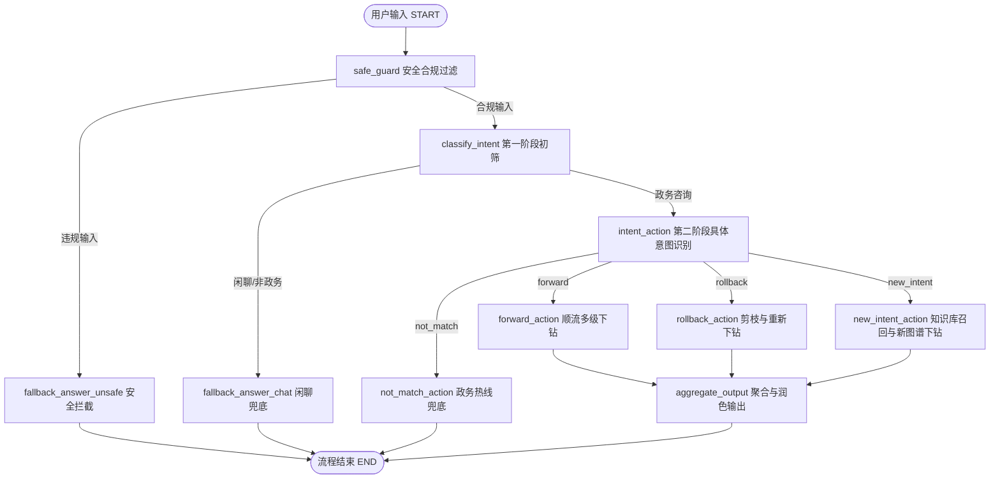

> 这个设计实践源于某智能问答项目考虑接入第三方决策图谱。当前该项目是基于fastgpt搭建的workflow RAG，在初步尝试时发现过于受限，仅能做到HAPPY PATH，具体的不过多阐述。本文主要描述在RAG四层结构的基础上如何接入决策图谱接口进行问答，技术栈使用LangGraph图。


## 决策图谱引发的难点

该决策图谱本质是一个决策树接口。调用它的方式是先检索知识库里每个图谱的能力以确定前置判断入口，获得图谱名称，然后再在图谱里面获取一级节点供用户选择，用户选择节点后返回当前节点的信息或者引导再去选择下一节点。

该决策图谱相较于我们原来使用的vectorRAG存在以下问题：vectorRAG是无状态的，而接入的决策图谱是黑盒有状态的。在vectorRAG的情况下，不管用户打什么字，每轮对话都只是把上下文拼起来改写后扔进向量库检索再进行相似度Top-k召回和大模型总结。它不需要记住走到哪一步也不需要考虑回退（这种只有在边聊边办的情况才需要）。如果决策图谱节点信息我们能一次性获取的话，也可以完全当作vectorRAG来使用。但遗憾的是每一个分支阶段只能按照节点依次调用下钻。

在智能问答的实际场景中，用户的问题是多样化的。同样，若用户已在首轮输入中给出详细问题的情况下，再让用户进行一个个点选节点是很不明智的选择。

所以， 接入决策图谱需要解决以下几个方面的问题：
    - 用户意图识别
    - 用户理解
    - 自主下钻
    - 跨图谱检索
    - 用户交互

## 设计重点
### 用户行为和体验
| 需求 | agent设计 | 备注|
| :--- | :--- |  :--- | 
| 用户输入为大白话| 意图识别节点识别用户问题归属事项 | | 
| 用户不理解政务用词| 需将政务用语翻译为白话，让用户更清晰地理解和选择。若要提供按钮选项需对原始文本和改写文本做映射，以更好地获取对应的node_id|必要时维护一张政务用语映射表|
| 用户输入跨越不同的事项图谱 | 并发检索图谱 综合结果回应 并行分支汇总润色回复 提供不同追问|动态fan out/in 采用asyncio|
| 用户输入和条件是否缺失|llm判断下钻理由是否充分，明确则直接下钻，模糊场景交由用户确认| 循环熔断机制|
| 支持用户多选按钮和自由文本输入| 用户输入带入输入类型（文本/按钮） | |
| 用户输入非当前子节点的内容（如说“刚刚提的xxx”， “我好像填错了”），要能够回溯|区分回溯与新意图：回溯时定位回退锚点，执行主干剪枝切除失效分支后重新下钻；跳出当前事项则直接切入新图谱||

### agent输出和内部状态流转持久化
| 需求 | agent设计 | 备注|
| :--- | :--- |  :--- | 
|输出要直观多样| 需要用户选择时提供按钮卡片，文本回复时需要充分包含所有已知信息，返回大白话内容方便易懂||
|用户可能隔了一天再咨询| 当前thread的state持久化进redis，记住最新所在的图谱和节点，并做好ttl策略|通过checkpointer|
|用户意图改变时| 清空当前state记录的node和图谱名等，更新为新的图谱||
|内部状态|包含对话历史、当前图谱列表、当前节点列表、待选节点列表、了解到的用户个人属性（槽位信息）、历史节点轨迹、下钻链路||


## 架构设计
仍然是四层的结构设计： 
``` mermaid
graph TD
  Start["用户输入] --> Layer0["0. 输入合规校验层"] 
  Layer0 --> Layer1["1. 意图识别层 Intent Layer \n- 一阶段初筛 (classify_intent): 政务咨询 vs 纯闲聊 \n- 二阶段识别 (intent_action): 判定 forward / rollback / new_intent / not_match \n]                        
  Layer1 --> |路由分流| Layer2["2. 检索与下钻层 Retrieval & Traversal Layer \n- 分支执行: forward 并发下钻 / rollback 主干剪枝重钻 / new_intent 混合检索跨图谱下钻 \n] 
  Layer2 --> |汇总各分支下钻快照 traversal_results| Layer3["3. 聚合与输出层 Aggregation & Output Layer "]
```

### 输入合规校验层
这层主要是做代码关键词过滤和llm识别过滤兜底，存在风险的输入则进入兜底回答，并且用户输入不塞进历史对话以免污染上下文。注意一件事，对于用户直接点选待选节点的输入方式一般不会通过LLM进行识别，但是为防止接口输入内容被篡改，会对输入的节点文本进行匹配是否在候选中，若不匹配说明内容也被篡改了直接拦截。本层就不多赘述。

### 意图识别层
意图识别层分为两阶段，第一阶段意图识别用于判断当前输入为【政务咨询】或【闲聊】，而第二阶段意图识别为【政务咨询】分支下的具体意图。重点阐述第二阶段。

用户的意图归纳为以下三种：
  1. 【forward】：无论用户是直接点击选项按钮（```input_type=2```）、口语表达选项、追问、补充材料都属于在当前是路径事项上推进或者深入了解。
  2. 【rollback】：只要有想要返回之前的节点、后悔、改口都是想要返回之前的节点。
  3. 【new_intent】: 跳出当前话题，了解新图谱的情况

以上三种意图在识别的同时根据当前用户输入补充用户信息结构化抽取。而对于三种意图，还需要分别额外抽取以下信息：
    1. 【forward】需要抽取选择的节点、提取当前追问信息（查询改写）
    2. 【rollback】查询改写、用户想要回到的节点信息
    3. 【new_intent】: 提取用户想要查询的新事项的关键词

  但是存在一种情况：**用户的当前提问没有符合待选择的节点也没有符合的历史节点信息**，就归属于【not_match】，由于所有的知识都基于决策图谱，不适合额外做延伸，建议进入兜底回答，不要利用模型知识强行解释。

于是对于本轮的llm识别，需输出以下结构化信息：
```python
class IntentOutputSchema(BaseModel):
  user_intent: Literal["forward","rollback","new_intent","not_match"] #用户意图
  current_query: str #用户当前输入改写
  matched_options: List[Dict[str, str]] #forward填写当前路径待选择中最匹配的节点，可多选
  rollback_node: Dict[str, str] #rollback情况下回到最符合的节点
  new_topics: str #new_intent情况下用户的关键词
  user_info: Dict[str,Any] #无论什么意图，都要抽取全局事实抽取
```

在prompt设计的时候，起初把`new_intent` 定义仅简单定义为“**跳出当前话题**”，在测试的时候发现，由于用户首轮输入是不存在【待选择选项】和【历史节点轨迹】，大模型在理解时又很死板——认为首轮压根没有“当前话题”可跳出，又没有节点可匹配，于是直接判 `not_match` 进了热线兜底。解法是在prompt和代码补充【待选择选项】和【历史节点轨迹】为空时，只要表达了咨询诉求，就判定为`new_intent`，因为在决策树场景下，只有首轮或者先前输入全被拦截的情况下才会出现二者为空。


起初的状态设计思路是在该层级确定好用户的意图后直接在状态里确认好下一层将下钻的起始节点。用户输入为点击选项时这个路径简单清晰，但是涉及到用户自然语言输入后，要兼顾”怎么取数、怎么走路径“，导致意图识别节点逻辑过重，状态设计混乱。于是选择将职责进行剥离，在该节点仅判定 `forward / rollback / new_intent / not_match` 四个动作，并输出改写后的 `current_query` 和动作参数（`matched_options` / `rollback_node` / `new_topics`），把路径更新与下钻交给下钻层处理。

于是无论是哪一种意图，我们在本节点的state更新就不用考虑回退要回到哪个节点、往下走要走到哪个节点跨哪些图谱、要怎么更新`current_node`等相关字段。我们把本轮输出视为一个信息，提供统一的意图识别结果包。

当前意图识别层需要update的MainState内容如下：
```python
class MainState(TypedDict):
  user_info: Dict[str,str]
  intent_res: IntentResItem
  current_query: str   #把current_query和user_info拆除来，点击按钮就不改写了

class IntentResItem(TypedDict):
    # 意图识别结果包
    user_intent: Literal["forward","rollback","new_intent","not_match"] #用户意图
    matched_options: NotRequired[List[Dict[str, str]]] #forward填写当前路径待选择中最匹配的节点，可多选
    rollback_node: NotRequired[Dict[str, str]] #rollback情况下回到最符合的节点
    new_topics: NotRequired[str] #new_intent情况下用户的关键词
```

在遇到用户问题是跨事项图谱的情况下，给出所有的`matched_options`以支持下一层级的并发执行。

### 检索下钻层
这一层级根据上一层得到的意图结果分流进入不同的执行节点：
1. **forward**：沿当前事项路径下钻获取数据，支持多选项并发下钻与单分支自动多级下钻
2. **rollback**：根据回退锚点执行历史主干剪枝，回到最符合的历史节点重新下钻
3. **new_intent**：跳出当前事项，基于知识库混合检索识别新图谱，并从根节点并发下钻
4. **not_match**：未命中任何有效事项节点，进入统一的政务热线兜底回答

#### 下钻设计：
针对下钻时考虑了几个问题：
1. **下钻限制**：由于在本层是利用llm自主判断是否需要下钻，只要模型觉得能下钻就再往下而不咨询用户。测试环境图谱结构较小，最多五层，但实际环境可能不止五层，这就可能存在一旦大模型某一步判断偏离一直下钻刷爆token，或者输出的下钻节点id为当前节点导致陷入死循环，因此设置硬性的熔断阈值最多下钻多少层。
2. **通用下钻函数设计**：pydantic校验仅能判断LLM是否按照结构化输出，而在该场景，还需要代码校验判断LLM输出的`target_node_id` 是否落在当前候选节点的内，以及`target_node_name` 与真实节点名称是否一致，防幻觉编造。若校验不通过则将具体的校验结果信息返回给大模型进行重试。
3. **下钻流转快照**：起初并未将下钻过程中经过的节点提供给最终的聚合层，这就导致自动下钻过程中部分节点包含的节点信息丢失，给到用户的只有最终节点的信息（有可能只有一个选项而没有任何解释说明）。多级自动下钻走过的每一个中间节点（前置须知、政策背景）、最终停靠落地节点、停靠原因（是叶子节点到底了，还是大模型判断信息已充分停靠，亦或是需要用户澄清互斥选项）都是关键的业务资产。把这些结构化快照存入 `traversal_results`，既能作为调试观测证据链，更能直接给下一层聚合层提供提取“前置政策”和“最终指南”的详实素材。
4. **绝不强行猜测**：在该决策树中存在两类分支：①排他互斥分支（单选）：如身份类别、户籍属性； ②平行并列分支（可多选）：如办事所需材料、关联申办等多个附带事项。当没有100%理由可以支撑LLM明确用户意图要具体收敛到哪一个分支时，大模型绝不能擅自帮用户单选出一个结果往下钻，而应该立即停止并且将候选项给到用户进行选择。

下钻判定的核心 Schema 定义：
```python
class DrillDownDecision(BaseModel):
    reason: str = Field(description="思考分析过程：分析用户当前诉求是否已被当前节点完整解答，以及后续子业务列表中是否存在精准匹配的选项")
    is_fully_answered: bool = Field(description="当前节点的 describeInfo 是否已经充分、闭环地解答了用户的所有核心诉求")
    should_drill_down: bool = Field(description="是否需要且能够继续自动下钻。若诉求已解答或输入模糊需人工确认，则为 False")
    target_node_id: Optional[str] = Field(default=None, description="若下钻，必须出自候选子节点的真实 node_id")
    target_node_name: Optional[str] = Field(default=None, description="匹配到的子节点名称")
```

#### 四类执行节点分支设计
1. 【forward】顺流多级下钻
- **触发条件**：上一轮用户意图为 `forward`（用户点击了选项按钮、口语表达选项或继续追问补充）。
- **执行逻辑**：
  1. 从 `intent_res` 提取 `matched_options`（支持多选）；
  2. 提取用于下钻判断的用户语义内容（优先使用改写后的 `current_query`）；
  3. 并发调用图谱接口，每一跳向图谱接口查询当前节点与子节点；
  4. 若到达叶子节点（无 children），强制停止；若有 children，调用自动下钻函数评估是否深入；
  5. 遇到停靠点时，将停靠节点的直接 children 转换为待选按钮放入，并附带生成大白话引导提问；
  6. 将本轮所有分支经过的过程节点追加到全局历史轨迹中。
- **State 更新**：
  - `current_node`：各分支最终停靠落地的节点列表；
  - `option_node`：停靠节点下挂载的直接候选按钮；
  - `history_node`：追加记录本轮走过的过程节点；
  - `traversal_results`：各分支下钻的完整链路报告。

2. 【rollback】回溯到历史节点
- **触发条件**：上一轮用户意图为 `rollback`（如“我不选这个了，我想换成本地户籍”或“回到上一步”）。
- **执行逻辑**：
  1. 从 `intent_res` 提取 `rollback_node`；
  2. 后续和forward一样，能自动下钻就下钻。
- **其他设计**：
  - **容错机制**：若模型未提取出明确的 `rollback_node`，保持原地不动，安全停靠在当前节点并追问用户以确认。
  - **历史记录怎么更新**：在清空历史、全部追加还是标记失效中，参考业内处理复杂对话树回溯的最佳实践最终选择**主干剪枝**的方式：在 `history_node` 中定位到用户想回退的目标节点 `rollback_target_id`，将该节点之后的所有历史分支全部截断切除，避免废弃旧分支污染上下文；然后以回退目标节点为起跑锚点，带着用户改口后的新提问，重新调用图谱接口和自动下钻函数向下下钻；将新走过的有效节点追加到剪枝后的主干后面，生成新的 `history_node`。

3. 【new_intent】新事项图谱
- **触发条件**：上一轮用户意图为 `new_intent`（跳出当前业务，询问全新事项）。
- **执行逻辑**：
  1. **知识库混合检索召回**：使用用户关键词 `new_topics` 或改写输入 `current_query`，检索知识库，召回 Top-6 候选事项片段；
  2. **事项名称清洗**：真实语料中有固定格式，通过正则提取并彻底清洗出规范事项名；
  3. **LLM 研判与跨图谱路由**：大模型结合用户诉求与候选事项能力说明，挑选 1~3 个目标事项。这里支持**跨事项**同时办理（例如既问了新生儿落户，又问了产妇生育津贴）；
  4. **从根节点并发下钻**：对锁定的目标事项，开始自动下钻。
- **State 更新**：
  - 替换 `knowledgement` 为新的事项列表；
  - 重构 `history_node` 为新图谱的探索轨迹；
  - 汇聚新图谱的 `current_node`、`option_node` 与 `traversal_results`。

4. 【not_match】未匹配兜底
- **触发条件**：上一轮意图为 `not_match`（用户的提问在政务库中完全无法匹配）。

### 聚合与输出层
这一层作为所有下钻分支统一汇聚的收敛节点。下钻层只负责查图谱、拿结构化节点数据；聚合层专门负责对多图谱、多节点的数据进行语义去重、大白话润色与界面元素组装。

针对本问答场景，下钻层输出的 `traversal_results` 包含了完整链路，聚合层将其解构为易懂的层次化结构。
  - **前置政策与须知**：提取链路中非叶子节点（祖先节点）的 `describe_info`，作为前提背景在大白话开头予以交代，避免市民盲目办事；
  - **落地具体指南**：重点提取停靠终点节点 `final_node` 的办理指南（适用对象、所需申报材料清单、办理时限等），使用结构化序号排版；
  - **跨事项结构化隔离**：若本轮涉及多个事项，自动采用二级标题分块呈现，各事项条理分明。

## 全局 LangGraph 流程拓扑


## 输入输出状态流转定义
全局 State 体系划分为前端输入状态、中间核心数据模型、全局 MainState 以及最终交付给前端的 OutputState：

#### 1. 前端输入定义 (`InputState`)
支持自然语言自由打字与点击结构化选项按钮两种交互模式：
```python
class SelectedOptionItem(TypedDict):
    graph_name: str  # 归属事项名称，如 "异地就医备案"
    option_text: str # 按钮文本，如 "常驻异地工作人员备案"

class InputState(TypedDict):
    user_input_type: Literal["1", "2"] # 1-自由输入，2-点击按钮
    raw_query: NotRequired[str]        # user_input_type == "1" 时使用
    selected_options: NotRequired[List[SelectedOptionItem]] # user_input_type == "2" 时使用
```

#### 2. 中间核心数据模型
```python
# 待选择选项节点（供前端渲染按钮，也是 LLM 判断下钻的候选项）
class OptionNodeItem(TypedDict):
    knowledge_name: str                  # 归属事项名称
    node_id: str                         # 图谱真实节点唯一ID
    node_name: str                       # 节点在图谱中的原始全称
    node_for_user: str                   # 按钮展示文本
    question_for_user: NotRequired[str]  # 引导问题提示

# 历史轨迹节点（记录已走过的节点，用于 rollback 回溯与主干剪枝）
class HistoryNodeItem(TypedDict):
    knowledge_name: str          # 所属事项
    node_id: str                 # 节点ID
    node_name: str               # 节点名称
    describe_structure: str      # 后续子节点概括
    describe_info: Optional[str] # 该节点曾输出的政策信息

# 当前停留落脚点
class CurrentNodeItem(TypedDict):
    knowledge_name: str # 所属事项
    node_id: str        # 当前节点ID
    node_name: str      # 当前节点名称

```

#### 3. 全局 MainState（全生命周期流转状态）
```python
class MainState(InputState):
    history_message: NotRequired[Annotated[list[BaseMessage], add_messages]] # 历史问答对上下文
    user_info: NotRequired[Dict[str, Any]]                # 结构化抽取的用户画像信息槽位
    knowledgement: NotRequired[List[str]]                 # 当前会话所绑定的事项图谱列表
    history_node: NotRequired[List[HistoryNodeItem]]      # 历史访问过的有效主干节点
    current_node: NotRequired[List[CurrentNodeItem]]      # 当前停靠节点
    option_node: NotRequired[List[OptionNodeItem]]        # 待选择的节点选项（按钮组）
    is_gov_affair: bool                                   # 是否咨询政务事项
    is_safe: bool                                         # 输入安全合规检查标志
    intent_res: NotRequired[IntentResItem]                # 意图识别层输出结果包
    current_query: str                                    # 用户当前输入改写
    clean_input_text: NotRequired[str]                    # 转换为自然语言后的清洗输入
    traversal_results: NotRequired[List[Dict[str, Any]]] # 本轮各分支多级下钻完整快照（包含过程节点与停靠原因）
    
    # 聚合层产出
    answer: NotRequired[str]                              # 总结生成的 Markdown 富文本大白话回答
    has_button: NotRequired[bool]                         # 是否需要渲染按钮
```

#### 4. 面向前端交付的标准视图 (`OutputState`)
通过 LangGraph 编译时的 `output=OutputState` 过滤掉庞大的内部下钻快照，只向前端返回纯净、标准且结构明确的响应：
```python
class OutputState(TypedDict):
    """LangGraph 面向前端 API 暴露的标准输出视图 (精简纯净)"""
    answer: str                                                 # Markdown 回答正文
    has_button: bool                                            # 前端控制：是否展示底部选项按钮组
    option_node: List[OptionNodeItem]                           # 待选按钮列表
    knowledgement: List[str]                                    # 当前事项图谱
    current_node: List[CurrentNodeItem]                         # 当前落脚点节点信息
    history_message: Annotated[list[BaseMessage], add_messages] # 最新问答对消息历史
```
